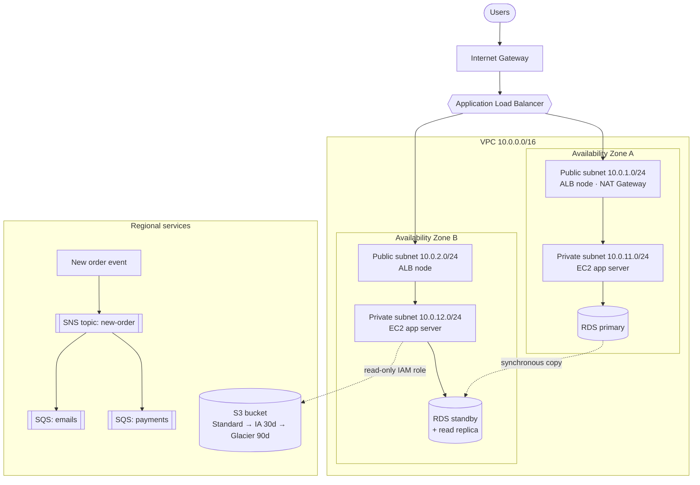

# AWS High-Availability Architecture Lab

A highly available, decoupled web application architecture on AWS. I designed it, built it step by step, and tested it by deliberately failing an Availability Zone. The repo includes an interactive practice lab and a CloudFormation template that deploys the same design to a real AWS account.

Built as part of my preparation for the **AWS Certified Solutions Architect – Associate** exam and my move from CRM and marketing systems into cloud and AI engineering.

> **Status:** designed and validated in the interactive lab (17 of 17 steps, AZ-failure test passed). The CloudFormation template passes `cfn-lint` but has **not yet been deployed** to a live account.

## The problem

A typical business web app has to:

- stay online if a data centre fails
- keep its database and servers away from the public internet
- give servers access to file storage without stored passwords or keys
- store files cheaply as they age
- pass events (such as a new order) to several systems without losing any when one is slow

## The architecture



| Layer | What I used | Why |
| --- | --- | --- |
| Network | VPC, 2 public + 2 private subnets across 2 AZs, Internet Gateway, NAT Gateway, S3 gateway endpoint | Only the load balancer faces the internet. Servers get outbound-only access for updates. |
| Security | Security groups chained ALB → app → database; IAM role with `AmazonS3ReadOnlyAccess` | Least privilege: each layer only accepts traffic from the one in front of it, and no access keys on servers. |
| Web tier | Application Load Balancer + Auto Scaling group (min 2) in private subnets | One server per AZ, with failed servers replaced automatically. |
| Database | RDS MySQL, Multi-AZ, private subnets, password in Secrets Manager, plus a read replica | Multi-AZ for automatic failover; the replica takes reporting load off the primary. |
| Storage | S3 with Block Public Access, encryption and a lifecycle rule | Files move to cheaper storage classes as they age. |
| Decoupling | SNS topic fanning out to two SQS queues | Each downstream system works at its own pace; nothing is lost during spikes. |

Design trade-offs are in [docs/architecture-decisions.md](docs/architecture-decisions.md).

## Resilience test

I failed Availability Zone A in the lab and checked what still worked:

| Check | Result |
| --- | --- |
| Load balancer still had a healthy node and targets in AZ B | Pass |
| Auto Scaling group still had a server in AZ B | Pass |
| Database failed over to the Multi-AZ standby in AZ B | Pass |
| **Application status** | **Running** |

Each of the three checks is also a common wrong answer on the exam if missed: a single-AZ load balancer, a minimum of 1 server, or a database without Multi-AZ.

## What's in this repo

```
├── lab/index.html                  Interactive practice lab: 7 guided labs, live architecture diagram, AZ-failure test
├── infrastructure/ha-web-app.yaml  CloudFormation template for the same architecture
└── docs/architecture-decisions.md  Why each choice was made, trade-offs, and production next steps
```

### Run the lab

Open `lab/index.html` in a browser, or enable GitHub Pages on this repo and visit `/lab/`. It runs entirely in the browser and needs no AWS account.

### Deploy to AWS (optional, costs money)

```bash
aws cloudformation deploy \
  --template-file infrastructure/ha-web-app.yaml \
  --stack-name ha-lab \
  --capabilities CAPABILITY_IAM
```

Open the `WebsiteUrl` output and refresh: the page shows which Availability Zone served it. Multi-AZ RDS, the read replica and the NAT Gateway are billed hourly and are **not** Free Tier. Delete the stack when finished:

```bash
aws cloudformation delete-stack --stack-name ha-lab
```

## Skills shown

AWS networking (VPC, subnets, routing, NAT) · IAM least privilege · load balancing and Auto Scaling · RDS Multi-AZ and read replicas · S3 storage classes and lifecycle · SNS/SQS decoupling · infrastructure as code (CloudFormation) · resilience testing

## Author

**Dwijesh Ramnath**, CRM automation and business systems specialist moving into AI engineering and cloud solutions architecture.
[GitHub](https://github.com/Dwijii) · [LinkedIn](https://linkedin.com/in/dwijesh-akshar-ramnath)
